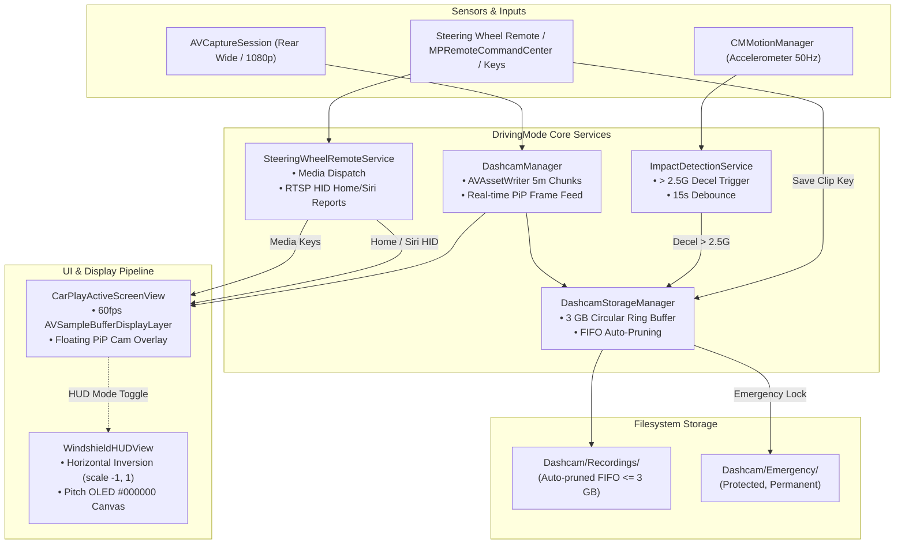

# Integrated Dashcam, Windshield HUD & Steering Wheel Remote — Architecture & Testing Design

> **Validated Design Document**
> Approved by User on 2026-10-23.

---

## 1. System Constraints & Requirements

| Constraint | Specification |
|---|---|
| **Platform & Target** | iOS / iPadOS 17.0+, Swift 5.9, Xcode 16 / Developer SDK. Physical test target: iPhone 15 Pro (`00008130-00126D081E43001C`). |
| **Concurrency & Pipeline** | Dashcam capture runs concurrently with zero-copy CarPlay 60fps H.264 decode (`VTDecompressionSession` → `AVSampleBufferDisplayLayer`) without CPU/GPU thermal contention. |
| **Dashcam Video Profile** | 1080p @ 30fps H.264, segmented into 5-minute `.mp4` chunks via `AVAssetWriter`. |
| **Storage & Quota** | Strict 3 GB max circular ring buffer (`Dashcam/Recordings/`). Automatic FIFO pruning of oldest non-emergency clips when quota is exceeded. |
| **Crash / Impact Vault** | Accelerometer decel spike (> 2.5G via `CMMotionManager` at 50Hz) or manual "Save Clip" locks the current and prior segment to `Dashcam/Emergency/` (immutable, never auto-pruned). |
| **Steering Wheel Remotes** | Standard Bluetooth media remotes (AVRCP) via `MPRemoteCommandCenter` (Play/Pause/Skip/Volume) + custom HID reports (`RTSPServer.sendHomeButtonHIDReport()`, `sendSiriHIDReport()`) for hardware buttons / key shortcuts. |
| **Windshield HUD Mode** | Horizontal optical inversion (`.scaleEffect(x: -1, y: 1)`) with pure pitch OLED black (`#000000`) background to project reflections cleanly onto car windshields at night without glare. |

---

## 2. Architectural Subsystems

### A. Dashcam & Storage Engine (`DashcamManager.swift` & `DashcamStorageManager.swift`)
- **Camera Pipeline:** Uses `AVCaptureSession` configured with `preset1920x1080` targeting the rear ultra-wide / wide angle lens (`AVCaptureDevice.DiscoverySession`).
- **Segmented Writing:** Real-time audio/video frames are fed into `AVAssetWriter`. Every 5 minutes (or upon emergency lock), the current file is finalized and a new segment starts seamlessly.
- **Circular Pruning:** Before initiating or finishing a clip, `DashcamStorageManager` calculates total directory size. When size exceeds 3 GB, oldest `.mp4` files in `Dashcam/Recordings/` are pruned sequentially. Files in `Dashcam/Emergency/` are excluded from pruning.
- **Picture-in-Picture Viewfinder:** A lightweight SwiftUI floating preview window (`DashcamPiPOverlay.swift`) can be moved around or minimized over the active CarPlay screen.

### B. Impact Detection & Emergency Lock (`ImpactDetectionService.swift`)
- **Sensor Loop:** `CMMotionManager` samples accelerometer updates at 50Hz.
- **G-Force Vector:** Magnitude calculated as $\lVert a \rVert = \sqrt{a_x^2 + a_y^2 + a_z^2}$.
- **Spike Trigger:** A sudden deceleration spike exceeding `2.5G` (configurable between 1.5G and 4.0G in Settings) triggers `onImpactDetected()`.
- **Debounce & Vault:** A 15-second debounce window prevents multiple triggers during one incident. Active segment and the preceding 5-minute chunk are copied/moved to `Dashcam/Emergency/dashcam_EMERGENCY_YYYYMMDD_HHmmss.mp4`.
- **Manual Trigger:** An in-app HUD button, steering remote button, or keyboard hotkey can invoke `saveCurrentEvent()`.

### C. Steering Wheel Remote & Hardware Controls (`SteeringWheelRemoteService.swift`)
- **Media Controls (AVRCP):** Registers listeners on `MPRemoteCommandCenter.shared()`:
  - `playCommand`, `pauseCommand`, `togglePlayPauseCommand`
  - `nextTrackCommand`, `previousTrackCommand`
  - `changePlaybackPositionCommand`
- **CarPlay Navigation & Siri HID Reports:**
  - Extended hardware remotes or keyboard keys (Arrow keys, Enter, Esc, Space, 'H' for Home, 'S' for Siri) translate to CarPlay HID reports sent over the encrypted RTSP event socket to the paired iPhone.
  - Quick action: Hotkey 'E' triggers emergency dashcam recording lock.

### D. Windshield Night HUD Reflection Mode (`WindshieldHUDView.swift`)
- **Optical Transform:** Windshield glass reflects images like a mirror. Inverting the screen horizontally (`.scaleEffect(x: -1, y: 1)`) ensures reflected text, speed numbers, and navigation arrows read normally from the driver's perspective.
- **OLED Night High-Contrast:** Background is forced to pure `#000000` (subpixels off on OLED displays) so zero light spills onto the windshield except the vital telemetry elements.
- **Telemetry HUD:** Displays:
  - Digital Speedometer (large high-visibility font)
  - Navigation prompt / turn direction icon
  - Current media pill (song title & artist)
  - Emergency Dashcam Status Indicator (Pulsing Red when recording, Amber when locked)
  - One-tap quick toggle to exit HUD mode or flip inversion.

---

## 3. Data Flow & State Machine

---

## 4. Test Strategy

1. **Unit Testing (`swift test`):**
   - `DashcamStorageManagerTests`:
     - Test directory creation and file segment naming format (`dashcam_YYYYMMDD_HHmmss.mp4`).
     - Test FIFO pruning when cumulative size exceeds 3 GB.
     - Test that files moved to `Emergency/` are never pruned.
   - `ImpactDetectionTests`:
     - Feed synthetic acceleration vectors: `(0, 0, 1.0G)` (normal driving) vs `(0, -2.8G, 0.5G)` (hard collision).
     - Verify callback fires on > 2.5G and respects 15-second debounce.
   - `SteeringWheelRemoteTests`:
     - Verify registration of `MPRemoteCommandCenter` handlers.
     - Verify keyboard / remote shortcuts trigger expected actions (Home, Siri, Save Clip).
   - `HUDModeTests`:
     - Verify configuration persistence (`isHUDModeEnabled`, `isHUDMirrored`).
     - Verify scale transform calculation for optical reflection.

2. **Physical Device Integration (`iPhone 15 Pro`):**
   - Validate camera permissions request (`NSCameraUsageDescription`, `NSMicrophoneUsageDescription`).
   - Validate concurrent 60fps CarPlay stream rendering + 1080p 30fps Dashcam recording.
   - Validate PiP viewfinder drag gesture and HUD optical reflection on dashboard glass.
