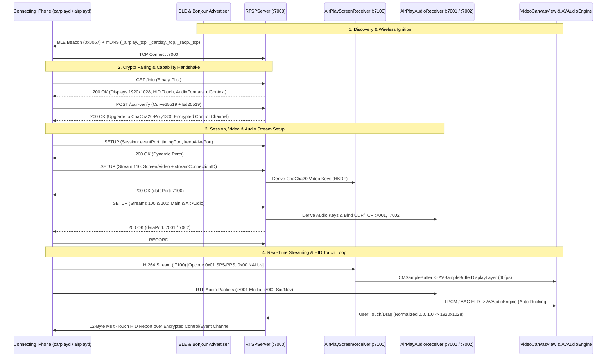

# Full Wireless CarPlay Receiver Mode — Architecture & Testing Design

> **Validated Design Document**
> Approved by User on 2026-10-23.

---

## 1. System Constraints & Requirements

| Constraint | Specification |
|---|---|
| **Scale** | Single active 1:1 wireless head-unit session per receiver device; supports seamless reconnect and device switching. |
| **Consistency** | Deterministic state machine (`idle` → `starting` → `waitingForPhone` → `connecting` → `streaming` → `error`). |
| **Latency** | **Video:** < 16.6 ms (60fps zero-copy `VTDecompressionSession` → `AVSampleBufferDisplayLayer`). **Touch HID:** < 10 ms normalized coordinate dispatch. **Audio:** < 40 ms RTP jitter buffer. |
| **Stack & Platform** | Swift 5.9, iOS / iPadOS 17.0+, `Network.framework`, `AVFoundation`, `VideoToolbox`, `CoreBluetooth`, `CoreAccessories`. |
| **Audio Flexibility** | User-selectable **In-Band AirPlay Audio** (with automatic navigation ducking) OR **Car Bluetooth Passthrough**. |

---

## 2. Architectural Options & Decision Record

### Option A: Video-Only Receiver (Mandatory Bluetooth Audio)
- **Approach:** Negotiate only Stream `110` (Screen/Video) in RTSP `SETUP` and ignore audio streams.
- **Pros:** Minimal code footprint; zero audio buffer management.
- **Cons:** iOS `airplayd` requires valid `audioFormats` and stream `100`/`101` port bindings during `SETUP`, or it terminates the CarPlay session after `RECORD`. Also prevents standalone AUX/speaker playback.

### Option B: Fixed In-Band AirPlay Audio + Video
- **Approach:** Always capture and play Streams `100` (Media) and `101` (Siri/Navigation) through the receiver device's `AVAudioEngine`.
- **Pros:** 100% CarPlay protocol compliance, lossless LPCM audio, native audio ducking.
- **Cons:** Forces audio onto the receiver device even when the driver prefers their phone connected directly to the factory car stereo over Bluetooth.

### Option C (Selected & Approved): Dual-Mode Full Receiver (In-Band Audio Engine + Bluetooth Passthrough Toggle)
- **Approach:** Implement the complete RTSP + Video (`110`) + Audio (`100`, `101`, `102`) protocol stack so iOS `airplayd` is 100% satisfied, paired with an `AudioRoutingMode` setting:
  1. **`.airPlayInBand` (Default):** Decodes and mixes Main Audio (`100`) and Alt Audio (`101`) via `AVAudioEngine` with automatic navigation ducking.
  2. **`.carBluetoothPassthrough`:** Completes RTSP audio stream negotiation at the protocol layer so CarPlay stays active, while configuring `AVAudioSession` with `.allowBluetoothA2DP` / muted receiver sink so audio routes cleanly to the car's Bluetooth stereo.

---

## 3. End-to-End Architecture & Data Flow

---

## 4. Component Specifications

### A. Discovery & Ignition (`CarPlayManager.swift`, `AirPlayBonjourAdvertiser.swift`)
- Call `bonjourAdvertiser.startAdvertising(name: carName, deviceId: deviceId)` inside `CarPlayManager.startReceiver()` and `bonjourAdvertiser.stopAdvertising()` inside `stopReceiver()`.
- Pass bound RTSP port (`rtspServer.boundPort`) to `AirPlayBonjourAdvertiser` and `CarPlayLockdownService`.
- Automatically invoke `startReceiver()` when launched on physical iOS hardware.

### B. Audio Receiver & Ducking Engine (`Sources/DrivingMode/Protocols/AirPlayAudioReceiver.swift`)
- Transport: Listens on UDP/TCP port `7001` (Main Media Stream `100`) and port `7002` (Alt Audio Stream `101` for Siri, Maps turn prompts, and alerts).
- Decryption: HKDF-derived ChaCha20-Poly1305 / AES-CTR encrypted RTP payloads using `streamConnectionID` from `SETUP`.
- Codec Support: LPCM 16-bit stereo (`44.1kHz` and `48kHz`) and AAC-ELD frames.
- AVAudioEngine Mixing & Ducking:
  - Two dedicated `AVAudioPlayerNode` instances: `mainAudioNode` (Stream 100) and `altAudioNode` (Stream 101).
  - Ducking Logic: Attenuates `mainAudioNode.volume` from `1.0` to `0.25` when Stream 101 is active, restoring to `1.0` with smooth ramp.
- `DrivingModeConfig.audioRoutingMode`:
  - `.airPlayInBand`: Plays through `AVAudioEngine`.
  - `.carBluetoothPassthrough`: Silences local player nodes while keeping protocol alive so phone plays via car Bluetooth.

### C. RTSP Audio & Control Enhancements (`RTSPServer.swift`)
- Multi-Stream `SETUP` Parsing:
  - `type == 110` (Video): Return `["type": 110, "dataPort": 7100]`.
  - `type == 100` or `102` (Main Audio): Return `["type": type, "dataPort": 7001, "controlPort": 7003, "audioBufferSize": 8192]`.
  - `type == 101` or `106` (Alt / Speech Audio): Return `["type": type, "dataPort": 7002, "controlPort": 7004, "audioBufferSize": 8192]`.
- Parse `volume` changes and `FLUSH` events.

### D. Video Pipeline & Keyframe Recovery (`AirPlayScreenReceiver.swift`)
- Maintain 1-byte opcode switch (`0x00` H.264 slice, `0x01` SPS/PPS configuration, `0x02`/`0x05` heartbeat).
- Automatic keyframe recovery: trigger `rtspServer.requestKeyFrame()` on missing SPS/PPS or packet loss.

### E. Settings & Receiver Standby UI (`SettingsView.swift`, `CarPlayActiveScreenView.swift`)
- Audio Output Mode picker in `SettingsView` (`In-App Speaker / AUX` vs `Car Bluetooth Stereo`).
- Enhanced connection telemetry and waiting overlay.

---

## 5. Comprehensive Testing Strategy

- `BonjourAdvertisementTests`: Verify service initialization, MAC formatting, and TXT record keys.
- `RTSPStreamNegotiationTests`: Loopback client asserts `200 OK` and port assignments (`7100`, `7001`, `7002`).
- `StreamKeyDerivationTests`: HKDF key derivation for `streamConnectionID`.
- `VideoNALUParserTests`: Synthetic header + SPS/PPS + IDR slice to `CMSampleBuffer`.
- `AudioReceiverAndDuckingTests`: Synthetic RTP packets, dB mapping, and ducking volume transitions.
- `HIDTouchReportTests`: 12-byte little-endian binary layout clamping.
